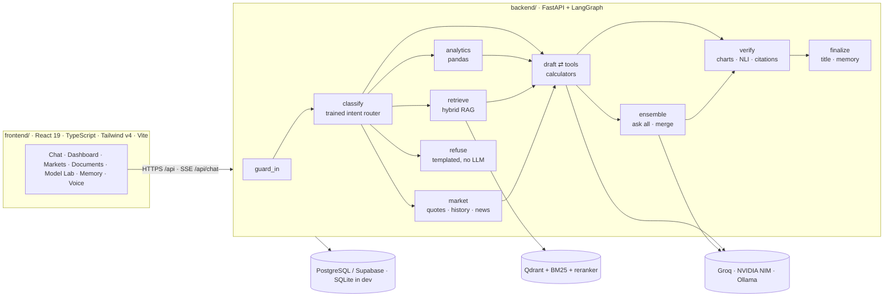

<div align="center">


# Sphura

**A finance-only AI assistant for India that shows its working.**

Sphura reads your bank statements, balance sheets and P&L workbooks, explains tax, loans and investing in plain language,
checks live markets, and answers with computed figures, charts and cited sources — never with numbers it made up.

*Sanskrit **sphur** (स्फुर्) — "to flash into view": the moment a question becomes an answer.*

<br/>


[Features](#features) · [Architecture](#architecture) · [ML inside](#the-machine-learning-inside) ·
[Quick start](#quick-start) · [Deployment](#deployment) · [Testing](#testing) · [API](#api-overview)

</div>

---

## Table of contents

- [Why Sphura](#why-sphura)
- [Features](#features)
- [Architecture](#architecture)
- [Sphura Ensemble: three models, one answer](#sphura-ensemble-three-models-one-answer)
- [The machine learning inside](#the-machine-learning-inside)
- [Tech stack](#tech-stack)
- [Repository layout](#repository-layout)
- [Quick start](#quick-start)
- [Configuration](#configuration)
- [Deployment](#deployment)
- [Testing](#testing)
- [API overview](#api-overview)
- [Security](#security)
- [Honesty and limitations](#honesty-and-limitations)
- [Acknowledgements](#acknowledgements)
- [License](#license)

---

## Why Sphura

General chatbots are fluent about money but unreliable with it: they do arithmetic in their heads, invent tax slabs,
and give "buy this stock" advice they are not qualified to give. Sphura is built the other way round:

| Principle | How it is enforced |
|---|---|
| **Numbers come from code, not from the model** | EMI, SIP, FD/RD, income tax (old vs new regime), ratios and every statement figure are computed by tools and pandas; the model only explains them. |
| **Every claim is checkable** | Answers cite numbered sources; a local NLI model scores each cited sentence against its source and shows a groundedness score. |
| **Finance only, and honest about it** | A trained intent router sends off-topic requests to an instant, templated refusal that never touches a language model. |
| **Education, not advice** | "Should I buy X?" gets the educational framing plus a SEBI disclaimer — never a personalised buy/sell/hold call. |

## Features

| | Feature | What makes it special |
|---|---|---|
| 💬 | **Finance chat** | Token streaming over SSE, stop / regenerate / edit, Markdown, tables, LaTeX, conversation history, light and dark themes, mobile layout |
| 🧭 | **LangGraph agent** | Every turn runs through a typed graph: guard → classify → spending · documents · market · explain · advice · out-of-scope → draft ⇄ tools → (ensemble) → verify → finalise. The graph is rendered live in the Model Lab |
| 🤝 | **Sphura Ensemble** | One best model per provider — Groq, NVIDIA and a local model — answer in parallel; the lead model streams a merged answer that keeps only what the sources support |
| 🧮 | **Calculators the model cannot get wrong** | EMI, SIP future value, FD / RD maturity, income-tax estimate (both regimes, slabs stored with source and date), liquidity / leverage / profitability ratios |
| 📊 | **Charts in answers** | Spending by category, money in/out by month, balance sheet, profit & loss (this year vs last) and price history — built from computed figures, rendered with Recharts, CSV export |
| 📄 | **Document intelligence** | PDF / DOCX / XLSX / CSV / images (OCR for scans); hybrid retrieval (dense + BM25 + RRF) with a cross-encoder reranker; page-level citations |
| 📈 | **Excel understanding** | Indian bank statements (SBI / ICICI / Kotak-style exports), Schedule III and MSME balance sheets, and P&L sheets in the same workbook: margins, growth, interest cover, ROE / ROA, "₹ crore" units read from the sheet |
| 💹 | **Markets** | NSE / BSE / US quotes and history (yfinance, cached), finance news with sentiment chips from our own classifier, watchlist |
| ✅ | **Verified answers** | Natural-language-inference check of cited sentences, numeric grounding, phantom-citation removal |
| 🎙️ | **Hands-free voice** | Groq Whisper speech-to-text; sentence-pipelined speech (Groq Orpheus → Gemini → browser voice, with automatic fail-fast fallback) |
| 🔐 | **Accounts** | Email + password or Google (Supabase OAuth), httpOnly session cookie, admin role, per-user data isolation |
| 🧪 | **Model Lab** | Every trained model with metrics, confusion matrix and baseline; the fine-tune report; the retrieval benchmark; the agent graph |

## Architecture



Each turn streams typed Server-Sent Events — `start → status → step → sources → delta → verification → title → done` —
defined in [docs/CONTRACT.md](docs/CONTRACT.md). The design notes behind the graph, the training plan and the persona
tests are in [docs/FINANCE_PLAN.md](docs/FINANCE_PLAN.md).

## Sphura Ensemble: three models, one answer

The model picker offers one best model per provider plus **Sphura Ensemble** (the default):

| Member | Model | Role |
|---|---|---|
| Groq | `openai/gpt-oss-120b` | Lead: runs the tool loop (calculators, market data, documents) with its text held back, then streams the merge |
| NVIDIA NIM | `nvidia/nemotron-3.5-super-vl-120b-a12b` | Answers in parallel from the same sources (full context) |
| Local (Ollama) | `qwen3.5:4b` | Answers in parallel from a compact prompt (word-capped); skipped when not loaded so it never delays the answer |

The merge prompt keeps the most accurate, specific content, trusts the numbered sources when candidates disagree, keeps
`[n]` citations and never mentions that answers were merged. If only one candidate succeeds it is sent as-is; if the
merge fails mid-stream, what already streamed is kept. Failover is automatic: NVIDIA falls back to Nemotron Lightning,
then DeepSeek V4.1 Flash; Groq falls back across providers.

Measured on a home connection (Groq + NVIDIA free tiers, RTX 3060 laptop for the local model): a full ensemble answer
with market data takes **≈ 13–15 s**; a single Groq answer **≈ 4 s**; NVIDIA alone **≈ 2 s to first token**.
Voice questions skip the ensemble and use the fastest single model.

## The machine learning inside

Everything below was trained or evaluated on a laptop (RTX 3060, 6 GB). Reports, confusion matrices, dataset cards
and the reproduction commands live in [backend/ml/README.md](backend/ml/README.md) and in the app under **Model Lab**.

| Component | Model | Result (held-out) | Baseline |
|---|---|---|---|
| Transaction categoriser | TF-IDF + logistic regression; DistilBERT (ONNX int8) answers the rows TF-IDF is unsure of | **98.6 %** accuracy, macro-F1 0.987 (430 rows) · **64.9 %** on 222 rows from merchants never seen in training | Rules: 72.3 % · 32 % unseen |
| Financial sentiment | DistilBERT fine-tuned, ONNX int8 | **86.8 %** accuracy, macro-F1 0.832 (2,861 sentences: Financial PhraseBank + Twitter Financial News) | Lexicon: 69.3 % |
| Finance intent router | Logistic regression on `bge-small` embeddings | **95.8 %** accuracy · **92.1 %** on unseen phrasing templates (5-fold) | Keywords: 56.7 % |
| Retrieval | `bge-small-en-v1.5` + BM25 + RRF + `ms-marco-MiniLM` reranker | Recall@5 **0.943**, MRR **0.866**, nDCG@10 **0.892** (18 docs, 122 questions) | BM25: R@5 0.877, MRR 0.775 |
| Fine-tuned assistant | `sphura-fin-1.7b` = Qwen3-1.7B + QLoRA (r = 16), 196 steps / 59 min | Held-out perplexity **63.3 → 6.2**; off-topic refusal 0 → 74 % | See the honest notes below |
| Groundedness | `nli-deberta-v3-xsmall` (ONNX, CPU) | Entailment of each cited sentence by its source | — |

## Tech stack

| Layer | Technologies |
|---|---|
| **Frontend** | React 19, TypeScript 6, Vite 8, Tailwind CSS v4, shadcn/ui (Radix), TanStack Query, Zustand, React Router 7, Framer Motion, Recharts, KaTeX, Supabase JS (OAuth only), oxlint |
| **Backend** | Python 3.12, FastAPI, Uvicorn, Pydantic v2, SQLAlchemy 2 (+ psycopg 3), LangGraph + LangChain, sse-starlette |
| **LLM providers** | Groq, NVIDIA NIM (OpenAI-compatible), Ollama (local), Gemini (optional) |
| **Retrieval** | Qdrant (embedded or cloud), FastEmbed (`bge-small`), BM25, cross-encoder reranker, PyMuPDF, python-docx, RapidOCR |
| **ML** | scikit-learn, ONNX Runtime, Hugging Face tokenizers; training with PyTorch, Transformers, PEFT, TRL, bitsandbytes |
| **Data & markets** | pandas, openpyxl, yfinance, Tavily / DuckDuckGo search |
| **Infra** | Docker, docker compose (Postgres + Qdrant + API + nginx), Supabase (Postgres + Google OAuth), Vercel, Render |

## Repository layout

The repo is a monorepo with two independently deployable apps:

```
sphura/
├── frontend/                 React SPA  →  deploy on Vercel (vercel.json) or any static host
│   ├── src/                  pages, components, stores, API client (src/lib/api.ts → VITE_API_URL)
│   ├── vercel.json           SPA fallback + /api rewrite to the backend
│   ├── Dockerfile, nginx.conf   self-hosted alternative (nginx serves the SPA and proxies /api)
│   └── .env.example
├── backend/                  FastAPI API  →  deploy on Render (render.yaml) or any Docker host
│   ├── app/
│   │   ├── agent/            LangGraph graph, nodes (classify … ensemble … verify), tools, streaming
│   │   ├── api/              HTTP routers (auth, chat, documents, finance, market, voice, ml, …)
│   │   ├── features/         finance (bank · balance sheet · P&L) · market · verify · memory · voice
│   │   ├── llm/              provider catalog, registry, failover, local-model discovery
│   │   └── rag/              parsers, OCR, chunker, embeddings, Qdrant store, hybrid retriever
│   ├── ml/                   datasets, training scripts, trained artifacts (ONNX / joblib), reports
│   ├── tests/                333 pytest tests (offline: mock model, no network keys needed)
│   └── Dockerfile
├── training/                 QLoRA fine-tune of sphura-fin-1.7b, DistilBERT classifier training
├── samples/                  demo statement + Excel test workbooks with an answer key
├── scripts/                  persona tests over the live API, workbook tests, test-data generators
├── docs/                     API contract (CONTRACT.md), design notes (FINANCE_PLAN.md), DEPLOYMENT.md
├── render.yaml               Render Blueprint for the backend
├── docker-compose.yml        one-command local stack
└── .env.example              every backend setting, documented
```

## Quick start

### Prerequisites

- Python **3.12** (3.13 works, without the OCR engine) and Node.js **22+**
- At least one model provider: a free [Groq](https://console.groq.com/keys) key, a free
  [NVIDIA NIM](https://build.nvidia.com) key, or [Ollama](https://ollama.com) with `ollama pull qwen3.5:4b`

### 1. Configure

```bash
git clone https://github.com/Prathameshdahe/sphura.git
cd sphura
cp .env.example .env          # add GROQ_API_KEY and/or NVIDIA_API_KEY
```

### 2a. Run everything with Docker

```bash
docker compose up --build
```

Open <http://localhost:3000> and create an account (the first account becomes admin unless `ADMIN_EMAILS` is set).

### 2b. Development mode (hot reload)

```bash
# backend → http://localhost:8000
cd backend
python -m venv .venv
.venv/Scripts/pip install -r requirements.txt        # macOS/Linux: .venv/bin/pip
.venv/Scripts/python -m uvicorn app.main:app --reload --port 8000
```

```bash
# frontend → http://localhost:5173 (proxies /api to :8000)
cd frontend
npm install
npm run dev
```

Development needs no database or vector server: SQLite and an embedded Qdrant are used automatically.

### 3. Try it in five minutes

1. **Dashboard** — upload `samples/bank_statement_demo.csv` → spending by category and month → *Discuss in chat*.
2. **Chat** — "EMI for a 25 lakh home loan at 8.5 % for 20 years" → the EMI tool runs; the answer shows the formula.
3. **Tax** — "I earn 12 LPA, which regime is better?" → both regimes computed from stored slabs, with their source.
4. **Excel** — upload `samples/test_workbooks/company_financials_fy26.xlsx` → balance sheet and P&L, margins, ROE, charts.
5. **Markets** — "How has Infosys performed over the last 3 months?" → quote, price chart, cited sources.
6. **Guardrails** — "Should I buy Reliance?" → education plus a disclaimer; "recipe for biryani" → instant refusal.

## Configuration

All backend settings are environment variables (or the repo-root `.env`); [`.env.example`](.env.example) documents
every one. The ones that matter most:

| Variable | Purpose |
|---|---|
| `GROQ_API_KEY`, `NVIDIA_API_KEY` | Cloud models (Groq also powers Whisper speech-to-text) |
| `GROQ_MODEL`, `NVIDIA_MODEL`, `NVIDIA_FAST_MODEL`, `NVIDIA_FALLBACK_MODEL`, `LOCAL_MODEL` | One best model per provider (the ensemble members and their backups) |
| `DEFAULT_MODEL` | `ensemble:sphura` by default; or e.g. `groq:openai/gpt-oss-120b` |
| `DATABASE_URL` | Postgres (Supabase session pooler URI works as-is); empty = SQLite |
| `QDRANT_URL`, `QDRANT_API_KEY` | Qdrant Cloud; empty = embedded Qdrant on local disk |
| `JWT_SECRET`, `ENVIRONMENT=production` | Production refuses to start with weak secrets |
| `CORS_ORIGINS`, `COOKIE_SECURE`, `COOKIE_SAMESITE` | Browser origins and session-cookie mode for split deployments |
| `SUPABASE_URL`, `SUPABASE_PUBLISHABLE_KEY`, `ADMIN_EMAILS` | Google sign-in and admin accounts |
| `TAVILY_API_KEY` | Finance news search (DuckDuckGo is the no-key fallback) |

The frontend has a single build-time variable, `VITE_API_URL` (see [`frontend/.env.example`](frontend/.env.example)).

## Deployment

Frontend and backend deploy **separately**. Full step-by-step instructions: **[docs/DEPLOYMENT.md](docs/DEPLOYMENT.md)**.

| App | Recommended host | Config in this repo | Notes |
|---|---|---|---|
| `frontend/` | **Vercel** (root directory `frontend`) | [`frontend/vercel.json`](frontend/vercel.json) | Static build; `/api/*` is rewritten to the backend so the session cookie stays first-party |
| `backend/` | **Render** (Docker) | [`render.yaml`](render.yaml) | Needs **≥ 2 GB RAM** (embedding, reranker, NLI and ONNX models stay in memory) |
| `backend/` (free alternative) | **Hugging Face Spaces** (Docker, 16 GB RAM) | [`backend/Dockerfile`](backend/Dockerfile) | Set `PORT=7860` |
| Database | **Supabase** Postgres | `DATABASE_URL` | Session pooler URI; tables are created at start-up |
| Vectors | **Qdrant Cloud** (free 1 GB) | `QDRANT_URL`, `QDRANT_API_KEY` | Keeps document embeddings across redeploys |

Two ways to connect the apps:

1. **Rewrite (recommended):** set the backend URL in `frontend/vercel.json`, leave `VITE_API_URL` empty,
   keep `COOKIE_SAMESITE=lax`. The browser only ever talks to the Vercel domain.
2. **Direct:** set `VITE_API_URL=https://<backend>` on Vercel and, on the backend, `CORS_ORIGINS=https://<frontend>`,
   `COOKIE_SAMESITE=none`, `COOKIE_SECURE=true`.

## Testing

```bash
cd backend && .venv/Scripts/python -m pytest -q          # 333 tests, offline (mock LLM, no keys needed)
cd frontend && npm run build && npm run lint              # type-check + production build + oxlint
python scripts/workbook_test.py                           # 5 Excel workbooks vs samples/test_workbooks/answer_key.json
python scripts/persona_test.py --email you@example.com --password …   # 19 persona scenarios against a running API
```

Latest persona run: **19 / 19 passed** ([scripts/persona_results.json](scripts/persona_results.json)) — including turns
that failed over from a rate-limited Groq to NVIDIA without the user noticing. Workbook test: **5 / 5**.

The backend suite covers the agent graph (routing per persona, tool rounds, failover, the ensemble and its merge),
streaming contracts, RAG, the finance parsers (bank / balance sheet / P&L), charts, citations, verification, memory,
voice and auth.

## API overview

All routes are under `/api`, return camelCase JSON, report errors as `{"detail": string}` and authenticate with an
httpOnly session cookie. The complete contract is in [docs/CONTRACT.md](docs/CONTRACT.md).

| Area | Endpoints |
|---|---|
| Auth | `POST /auth/register` · `POST /auth/login` · `POST /auth/logout` · `GET /auth/me` · `GET /auth/providers` · `POST /auth/oauth/supabase` |
| Chat | `POST /chat` (Server-Sent Events) · `GET /conversations` · `GET/PATCH/DELETE /conversations/{id}` · `POST /feedback` |
| Models & agent | `GET /models` · `GET /agent/graph` · `GET /health` |
| Documents | `POST /documents` · `GET /documents` · `GET/DELETE /documents/{id}` |
| Finance | `POST /finance/analyze` |
| Markets | `GET /market/search` · `GET /market/quote` · `GET /market/history` · `GET /market/news` |
| Voice | `POST /voice/transcribe` · `POST /voice/speak` · `GET /voice/status` |
| Memory | `GET/POST/DELETE /memory` · `DELETE /memory/{id}` · `PUT /memory/settings` |
| Verification & Model Lab | `POST /verify/{messageId}` · `GET /ml/verification` · `GET /ml/report` · `POST /ml/train/{key}` (admin) |

## Security

- httpOnly session cookies (SameSite Lax by default; None + Secure only for cross-origin deployments), bcrypt
  password hashes, rate-limited login, JWT secret required in production.
- Per-user isolation on every resource — filtered inside the vector store, not after retrieval.
- SSRF-guarded web reader, size and duration limits on uploads and voice clips, sandboxed iframes for rendered diagrams.
- No secrets in the repository: `.env` is git-ignored; keys are read from the environment only.
- Messages are redacted before they reach a cloud model: card numbers, bank account numbers, Aadhaar, PAN and
  CVV / PIN / OTP values are replaced by typed placeholders.

## Honesty and limitations

- **Educational, not advice.** Sphura is not a SEBI-registered investment adviser and says so.
- **Tax rules** are stored with their source and "as of" date in `backend/app/finance_rules.yaml`; verify them before
  relying on a number. **Market data** is delayed.
- **Unseen merchants:** the categoriser reaches 98.6 % on its test set but 64.9 % on merchants it has never seen —
  reported as-is, not tuned on the test workbooks.
- **The fine-tuned 1.7B model** learned the domain (perplexity 63 → 6) and to refuse off-topic requests (74 %), but
  over-refuses 18 % of finance prompts, loses FinQA exact-match (0.32 → 0.22) and was judged by a local 4B model
  (0 wins / 13 losses / 37 ties). It is offered in the picker without tools and is not the default.
- **Ensemble latency** is the slowest member plus the merge; voice mode uses a single fast model for that reason.

## Acknowledgements

Models and datasets used under their licences: Qwen3 (Apache-2.0), DistilBERT (Apache-2.0), BAAI `bge-small-en-v1.5`
(MIT), `ms-marco-MiniLM` cross-encoder (Apache-2.0), `nli-deberta-v3-xsmall` (Apache-2.0), Financial PhraseBank
(CC BY-NC-SA 3.0, academic use), Twitter Financial News Sentiment (MIT), Sujet-Finance-Instruct (Apache-2.0),
FinQA (MIT, via `flare-finqa`); model APIs by Groq and NVIDIA NIM; market data via yfinance (Yahoo Finance terms
apply). Third-party datasets and model weights keep their own licences; the MIT licence below covers this
repository's code.

## License

[MIT](LICENSE) © 2026 Prathamesh Dahe
